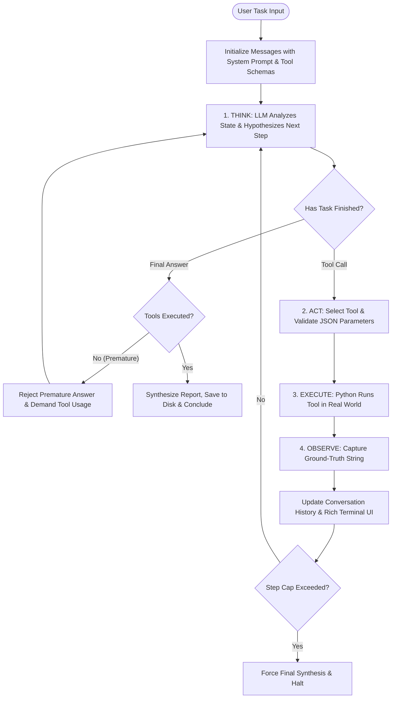

<div align="center">

# 🧠 ARIA
### **Autonomous Research & Intelligence Agent**

*A transparent, framework-free AI agent implementing the ReAct pattern to plan, execute, observe, and synthesize multi-step research missions.*

[](https://www.python.org/)
[](https://opensource.org/licenses/MIT)
[](#-the-react-engine)
[](#-dual-llm-engine)
[](#-testing--verification)

[Quickstart](#-quickstart-in-60-seconds) •
[Architecture](#-architecture--design) •
[Tools](#-the-5-production-tools) •
[ReAct Protocol](#-the-react-engine) •
[Trace Logs](#-audit-ready-trace-logging) •
[Learning Guide](HOW_IT_WORKS.md)

---

</div>

## 📌 Highlights

Unlike typical LLM demos that guess an answer in a single prompt, **ARIA** is an autonomous agent with sensory perception, working memory, and disk/web tools. It thinks before it acts, executes real-world tools, observes the results, self-corrects, and persists an audit trail.

- 🚀 **Hand-Rolled ReAct Loop**: Zero framework lock-in. No LangChain, CrewAI, or AutoGen bloat — just 100% clean, understandable Python.
- 🛠️ **5 Real-World Tools**: Live web search (`ddgs`), local file reader, report writer, short-term scratchpad memory (`notepad`), and deterministic statistical NLP (`analyze_text`).
- ⚡ **Dual Provider Engine**:
  - **Groq Cloud**: Blazing-fast inference (~300 tokens/sec) on Llama 3.3 70B with ~6,000 requests/day free.
  - **Local Ollama**: 100% private, offline, zero-API-key execution on Apple Silicon / CPU.
- 🛡️ **Autonomous Guardrails**: Hard step ceiling, premature-exit prevention filter, consecutive error backoff, and SIGINT interrupt safety.
- 📊 **Audit-Grade Trace Logs**: Generates human-readable Markdown traces detailing every single thought, tool invocation, JSON parameter, and raw observation.
- 🎨 **Rich Terminal Interface**: Live styled console updates with progress spinners, colored thought cards, and timing telemetry.

---

## 🥊 Comparison: Why Hand-Rolled ReAct?

| Dimension | Raw LLM Chatbot | Heavy Frameworks (LangChain/CrewAI) | **ARIA (This Project)** |
|---|---|---|---|
| **Real-time Web Grounding** | ❌ Hallucinates old data | ⚠️ Complex tool wrapping layers | ✅ **Native DuckDuckGo search (zero keys)** |
| **Working Memory** | ❌ Lost in long contexts | ⚠️ Opaque vector store chains | ✅ **Explicit `notepad` scratchpad tool** |
| **Execution Transparency** | ❌ Black box | ⚠️ Obscured behind callback managers | ✅ **Step-by-step Rich UI & Markdown traces** |
| **Dependencies & Bloat** | N/A | ⚠️ 50+ packages, heavy churn | ✅ **6 lean, modern dependencies** |
| **Architectural Clarity** | N/A | ⚠️ Steep debugging curve | ✅ **Pure Python state machine you can read in 10 min** |

---

## 🔄 The ReAct Engine

ARIA is built on the **ReAct (Reasoning + Acting)** paradigm ([Yao et al., 2022](https://arxiv.org/abs/2210.03629)), synchronizing chain-of-thought reflection with tangible tool execution:



### The Turn Protocol

At every step $k$, ARIA produces a structured thought followed by an action:

```text
Thought: I need to investigate recent breakthroughs in solid-state battery energy density in 2026.
Action: web_search
Action Input: {"query": "solid state battery energy density 2026 breakthroughs", "max_results": 5}
```

Python intercepts the action, runs the tool, and injects the ground truth:

```text
Observation: [1] QuantumScape announces 800 Wh/L solid-state cell entering B-sample testing...
```

The loop repeats until ARIA concludes:

```text
Thought: I have gathered all verification metrics and written the report to output/batteries_2026.md.
Final Answer: Research complete. Report successfully generated with 4 primary citations.
```

---

## 🛠️ The 5 Production Tools

ARIA includes 5 registered tools forming a complete research pipeline:

```
┌────────────────────────────────────────────────────────────────────────┐
│                        ARIA TOOL REGISTRY                              │
│                                                                        │
│  🔍 web_search     ─► Live internet gathering via DuckDuckGo (no key)  │
│  📄 read_file      ─► Safe filesystem reader with bounds checking      │
│  ✏️  write_file     ─► Markdown report generator (auto output/ routing) │
│  📝 notepad        ─► Agent working memory (set/get/list/clear)        │
│  📊 analyze_text   ─► Zero-latency local NLP (facts/metrics/stats)     │
└────────────────────────────────────────────────────────────────────────┘
```

| Tool Name | Parameters | Purpose | Implementation |
|---|---|---|---|
| **`web_search`** | `query` *(str)*, `max_results` *(int)* | Live internet search for papers, news, and releases. | Uses `ddgs` library; zero API key required. |
| **`read_file`** | `file_path` *(str)*, `max_chars` *(int)* | Read local source materials, CSVs, or previous notes. | Smart path resolution (root + `output/`), 8KB safety clamp. |
| **`write_file`** | `file_path` *(str)*, `content` *(str)*, `mode` *(str)* | Writes polished reports and syntheses to disk. | Defaults to `output/`, auto-creates subfolders, supports append. |
| **`notepad`** | `action` *(str)*, `key` *(str)*, `value` *(str)* | Working memory scratchpad for plans & key findings. | In-memory key-value dictionary persistent across steps. |
| **`analyze_text`** | `text` *(str)*, `operation` *(str)* | Local deterministic extraction of facts, metrics, and dates. | Heuristic regex & frequency counter; runs in 0.001s. |

---

## 🛑 Guardrails & Safety Architecture

Autonomous agents easily get stuck in loops or fail silently. ARIA enforces **4 strict runtime guardrails**:

1. **Premature Exit Prevention**: Lazy LLMs often try to guess an answer on Step 1. ARIA's guardrail intercepts any premature `Final Answer` if no tools have been called yet and forces the agent to gather real evidence first.
2. **Hard Step Ceiling (`MAX_STEPS`)**: Configurable ceiling (default: 15). Prevents runaway loops, token burn, or API exhaustion.
3. **Consecutive Error Backoff**: If 3 consecutive tool invocations fail (e.g. invalid arguments or non-existent tools), ARIA safely terminates with a diagnostic dump.
4. **Context Clamping**: `read_file` bounds large files at 8,000 characters and `web_search` bounds results to prevent context window overflow.
5. **Signal Interruption (SIGINT / Ctrl+C)**: Catches user cancellation safely and flushes partial traces to disk.

---

## ⚡ Dual LLM Engine

ARIA works with both ultra-fast cloud inference and 100% private local inference:

### Provider 1: Groq Cloud (Recommended for Speed & Depth)
- **Model**: `llama-3.3-70b-versatile`
- **Speed**: ~300 tokens/second (blazing fast)
- **Free Quota**: ~6,000 requests/day at [console.groq.com](https://console.groq.com/keys) (no credit card required)

### Provider 2: Local Ollama (100% Offline & Free)
- **Models**: `llama3.1`, `llama2-uncensored:7b`, `gemma2`, or custom models
- **Speed**: Runs locally on Apple Silicon GPU / CPU
- **Privacy**: Zero external network requests; zero API key needed

---

## ⚡ Quickstart in 60 Seconds

### 1. Clone & Set Up Environment

```bash
git clone git@github.com:jashantiwari044/AI-Agent-That-Completes-a-Task.git
cd AI-Agent-That-Completes-a-Task

# Create virtual environment
python3 -m venv .venv
source .venv/bin/activate

# Install dependencies
pip install -r requirements.txt
```

### 2. Configure Environment

```bash
cp .env.example .env
```

Edit `.env` to choose your provider:

```ini
# Option A: Groq Cloud (Free at https://console.groq.com/keys)
LLM_PROVIDER=groq
GROQ_API_KEY=gsk_your_key_here
GROQ_MODEL=llama-3.3-70b-versatile

# Option B: Local Ollama (No API key needed)
# LLM_PROVIDER=ollama
# OLLAMA_MODEL=llama3.1
```

### 3. Verify System Health

```bash
python test_aria.py
```
*Expected: All 5 unit tests pass in < 0.01s.*

---

## 💻 CLI Usage & Examples

### Inspect Available Tools
```bash
python main.py --list-tools
```

### Run an Autonomous Research Mission
```bash
# General research task
python main.py "Research the current state of humanoid robotics in 2026 and save a report to humanoid_robots.md"

# Specify Groq provider with custom step limit
python main.py "Compare Rust vs Go for backend microservices" --provider groq --max-steps 8

# Run with local Ollama offline
python main.py "Research Python 3.14 features" --provider ollama --max-steps 5

# Analyze a local document
python main.py "Analyze this research paper and extract key statistics" --file data_sample.txt
```

### CLI Flag Reference

| Flag | Long Flag | Description | Default |
|---|---|---|---|
| `task` | *(positional)* | The objective or research question to execute. | Interactive prompt |
| `-p` | `--provider` | Choose `groq` or `ollama`. | Value in `.env` |
| `-m` | `--model` | Model name override. | Configured model |
| `-s` | `--max-steps` | Maximum reasoning iterations allowed. | `15` |
| `-f` | `--file` | Attach a local file for primary analysis. | `None` |
| | `--list-tools` | Print registered tools table and exit. | `False` |

---

## 📊 Audit-Ready Trace Logging

Every execution generates a comprehensive Markdown trace in `logs/trace_*.md` so reviewers can audit every step:

```markdown
# 📜 ARIA Agent Execution Trace

| Metric | Details |
|---|---|
| **Task** | `Research solid state battery advances in 2026` |
| **Status** | **Completed Successfully** |
| **Provider** | `groq` |
| **Model** | `llama-3.3-70b-versatile` |
| **Duration** | 4.82 seconds |
| **Total Steps** | 4 / 6 |

---

## 🔄 Step-by-Step Reasoning Loop

### Step 1 (2026-10-17 21:30:10)
⏱️ **Duration:** `1.42s`
💭 **Thought:**
> I need to search for recent milestones in solid-state battery commercialization for 2026.
🔧 **Action:** `web_search`
```json
{"query": "solid state battery commercialization 2026", "max_results": 5}
```
👁️ **Observation:**
```text
Web search results for: 'solid state battery commercialization 2026' (Found 5):
[1] QuantumScape Announces B-Sample Production
    Snippet: QuantumScape begins customer testing of solid-state lithium-metal cells...
    URL: https://www.quantumscape.com/news/...
```
```

---

## 📁 Repository Structure

```
AI-Agent-That-Completes-a-Task/
├── LICENSE                      # MIT Open Source License
├── README.md                    # Project documentation & reference
├── HOW_IT_WORKS.md              # In-depth architectural & pedagogical masterclass
├── requirements.txt             # Lean dependencies (groq, ddgs, rich, etc.)
├── .env.example                 # Environment template
├── .gitignore                   # Ignore .venv, .env, __pycache__, logs
├── main.py                      # CLI entrypoint with Rich argument parser
├── test_aria.py                 # Automated unit tests for all tools & ReAct loop
├── output/                      # Destination for generated research reports
├── logs/                        # Destination for reviewable Markdown trace files
└── aria/
    ├── __init__.py              # Package export
    ├── config.py                # Environment loading, timeouts, thresholds
    ├── llm.py                   # Unified Groq Cloud & Local Ollama client
    ├── agent.py                 # ReAct state machine, regex parser, guardrails
    ├── logger.py                # Rich terminal UI & Markdown trace generator
    ├── prompts.py               # ReAct system prompt & tool schema formatter
    └── tools/
        ├── __init__.py          # Tool registry (get_default_tools)
        ├── base.py              # BaseTool abstract base class
        ├── web_search.py        # DuckDuckGo search integration
        ├── file_reader.py       # Safe filesystem reader with bounds check
        ├── file_writer.py       # Safe report writer with auto-output routing
        ├── notepad.py           # Short-term scratchpad memory
        └── text_analyzer.py     # Deterministic NLP fact & metric extractor
```

---

## 🧪 Testing & Verification

ARIA includes an automated unit test suite verifying tool execution, error handling, state tracking, and ReAct loop convergence:

```bash
python test_aria.py
```

```
....╭────────────────────────────────────────────────────╮
│ 🧠 ARIA — Autonomous Research & Intelligence Agent │
│ Task: Test autonomous reasoning loop               │
│ Provider: MOCK | Model: mock-model | Max Steps: 5  │
╰────────────────────────────────────────────────────╯
────────────────────────────── Step 1 / 5 (0.00s) ──────────────────────────────
💭 Thought: I need to record my plan.
🔧 Action: notepad(action='set', key='plan', value='1. Verify 2. Synthesize')
👁️  Observation: Notepad: Saved note under key 'plan' (23 chars).

────────────────────────────── Step 2 / 5 (0.00s) ──────────────────────────────
💭 Thought: Plan recorded. I will now conclude.
👁️  Observation: Task marked complete by agent.

───────────────────────────── 🎯 Mission Complete ──────────────────────────────
╭─────────────────────────────── Final Response ───────────────────────────────╮
│ Task verified and successfully completed.                                    │
╰──────────────────────────────────────────────────────────────────────────────╯
.
----------------------------------------------------------------------
Ran 5 tests in 0.007s

OK
```

---

## 🤝 Contributing

Contributions, bug reports, and feature requests are welcome!

1. Fork the Project
2. Create your Feature Branch (`git checkout -b feature/AmazingFeature`)
3. Commit your Changes (`git commit -m 'feat: Add AmazingFeature'`)
4. Push to the Branch (`git push origin feature/AmazingFeature`)
5. Open a Pull Request

---

## 📄 License

Distributed under the **MIT License**. See [`LICENSE`](LICENSE) for more information.

---

<div align="center">

Built with ❤️ by **[Jashan Tiwari](https://github.com/jashantiwari044)**

*Star ⭐ this repository if you found it useful!*

</div>
